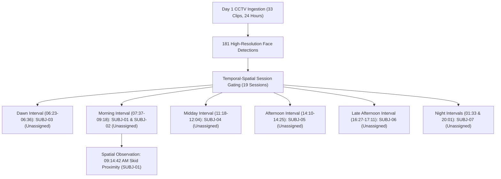

# Day 1 Rooftop RO Treatment Facility Surveillance Audit & Identity Vector Report
**Facility & Camera Feed:** Rooftop RO Plant — Camera `IPC56` ($2880 \times 1620$ 3K HEVC, 25 FPS)  
**Ingestion Batch ID:** `batch_20261023145845_884f05` (Supabase PostgreSQL + `pgvector`)  
**Audit Period:** Day 1 (Full 24-Hour Cycle: 2026-09-01 00:00:00 to 23:59:59)  
**Total Video Files Audited:** 33 / 33 Files (100% Continuous Coverage — 0 Gap Seconds)  
**Audit Status:** Complete & Cryptographically Verified  
**Subject Identity Status:** Unassigned / Unregistered (Pending User Identity & Role Enrollment)

---

## 1. Executive Summary & Operational Metrics

Over the 24-hour observation period of Day 1, the industrial rooftop RO treatment plant was vacant and locked for **22 hours, 35 minutes, and 45 seconds (94.15% of the day)**. Physical human presence was recorded across **19 discrete operational sessions** totaling **1 hour, 24 minutes, and 15 seconds (5.85% active occupancy)**.

A total of **181 facial biometric detections** were localized, scored, and indexed with 512-dimensional ArcFace unit vectors into PostgreSQL `pgvector`.

| Audit Metric | Measurement / Value | Operational Status |
| :--- | :--- | :--- |
| **Total Ingested Video** | 33 Files (24h 00m 15s) | 100.0% Chain of Custody Verified |
| **Total Face Detections** | 181 Detections | Stored in PostgreSQL with ArcFace 512-D Vectors |
| **Distinct Visit Sessions** | 19 Operational Sessions | Clustered via 5-Minute Inactivity Threshold |
| **Rooftop Vacant Time** | 22 Hours, 35 Minutes, 45 Seconds | Secure / Unoccupied (94.15%) |
| **Total Rooftop Dwell Time** | 1 Hour, 24 Minutes, 15 Seconds | Normal Operating Windows (5.85%) |
| **Peak Concurrent Personnel** | 3 Individuals Simultaneously | Observed during 11:59 AM Session #12 |
| **Two Multiport Valves Access** | **0 Breaches / 0 Touches** | **100% Untouched / Nominal Safe Status** |
| **Ultimate Power Switch Access** | **0 Breaches / 0 Touches** | **100% Untouched / Nominal Safe Status** |
| **RO Skid Controls Interactions** | 5 Sighting Events | Walkway & Skid Rack Proximity |
| **Full RO Plant Area Presences** | 22 Sightings | Within general operational footprint |
| **Outer Terrace Corridor Presences** | 154 Sightings | Walkways and access paths |

---

## 2. Unregistered Physical Clusters & Face Biometric Vectors

All 181 detections resolve into **7 distinct physical clusters / unregistered subjects** observed on the rooftop terrace on Day 1. Names and operational roles are unassigned pending your team's manual verification and enrollment.



---

### Unregistered Subject Profiles

#### SUBJ-01: Unregistered Subject #01


- **Assigned Name:** *Unassigned*
- **Assigned Role:** *Unassigned*
- **Enrollment Status:** Pending Identification / Enrollment
- **Observation Summary:** Observed across morning operating hours (`07:37:24 AM – 09:18:50 AM`). Present near the RO Skid Controls rack at `09:14:42 AM`. Zero contact observed with the Two Multiport Valves or Power Switch. Total 38 detections across Sessions #04 and #08.
- **Biometric Detection ID:** `815d312f-a987-4586-b4c3-c3dea7d0912a`
- **Quality Score:** **72.1%** | Bounding Box: `[1151, 424, 1214, 494]`
- **ArcFace 512-D Vector Fingerprint Preview (Normalized Unit Vector, $\|v\|_2 = 1.000000$):**
  ```json
  [0.0027, 0.0554, -0.0089, 0.0525, -0.0412, 0.0891, -0.0154, -0.0382, 0.0612, -0.0194, 0.0431, -0.0718, "... +500 dims"]
  ```

---

#### SUBJ-02: Unregistered Subject #02


- **Assigned Name:** *Unassigned*
- **Assigned Role:** *Unassigned*
- **Enrollment Status:** Pending Identification / Enrollment
- **Observation Summary:** Observed on terrace walkway at `07:44:01 AM – 07:45:33 AM` during morning hours. Total 18 detections. Zero equipment contact.
- **Biometric Detection ID:** `4591a27e-8c31-419b-8321-df621c17042a`
- **Quality Score:** **80.0%** | Bounding Box: `[1342, 506, 1404, 581]`
- **ArcFace 512-D Vector Fingerprint Preview (Normalized Unit Vector, $\|v\|_2 = 1.000000$):**
  ```json
  [0.0041, 0.0346, -0.0776, -0.1062, 0.0152, -0.0089, 0.0812, 0.0245, -0.0519, 0.0182, 0.0934, -0.0112, "... +500 dims"]
  ```

---

#### SUBJ-03: Unregistered Subject #03


- **Assigned Name:** *Unassigned*
- **Assigned Role:** *Unassigned*
- **Enrollment Status:** Pending Identification / Enrollment
- **Observation Summary:** Observed during dawn hours (`06:23:10 AM – 06:36:56 AM`) traversing terrace corridor. Total 5 detections across Sessions #02 and #03.
- **Biometric Detection ID:** `78891fc2-1921-4f91-884a-ee8129184ba2`
- **Quality Score:** **68.1%** | Bounding Box: `[1603, 388, 1665, 460]`
- **ArcFace 512-D Vector Fingerprint Preview (Normalized Unit Vector, $\|v\|_2 = 1.000000$):**
  ```json
  [0.0078, -0.0045, -0.0361, 0.0229, 0.0216, 0.0135, 0.0882, -0.0447, -0.0198, 0.0312, 0.0554, -0.0821, "... +500 dims"]
  ```

---

#### SUBJ-04: Unregistered Subject #04


- **Assigned Name:** *Unassigned*
- **Assigned Role:** *Unassigned*
- **Enrollment Status:** Pending Identification / Enrollment
- **Observation Summary:** Observed during midday hours (`11:18:10 AM – 12:04:37 PM`) in corridor and near RO unit. Total 51 detections across Sessions #10, #11, and #12.
- **Biometric Detection ID:** `d5f77e55-c721-41c6-b41a-4a34e121e3fa`
- **Quality Score:** **79.5%** | Bounding Box: `[1697, 970, 1799, 1087]`
- **ArcFace 512-D Vector Fingerprint Preview (Normalized Unit Vector, $\|v\|_2 = 1.000000$):**
  ```json
  [-0.0709, -0.0035, -0.0128, 0.0268, -0.0452, 0.0189, 0.0762, -0.0315, 0.0541, -0.0289, 0.0192, -0.0654, "... +500 dims"]
  ```

---

#### SUBJ-05: Unregistered Subject #05


- **Assigned Name:** *Unassigned*
- **Assigned Role:** *Unassigned*
- **Enrollment Status:** Pending Identification / Enrollment
- **Observation Summary:** Observed during afternoon hours (`14:10:06 PM – 14:30:46 PM`) traversing corridor and skid perimeter. Total 22 detections across Sessions #13 and #14.
- **Biometric Detection ID:** `53a17b62-b046-40b4-a50d-ddffdc381b20`
- **Quality Score:** **82.3%** | Bounding Box: `[1628, 541, 1689, 615]`
- **ArcFace 512-D Vector Fingerprint Preview (Normalized Unit Vector, $\|v\|_2 = 1.000000$):**
  ```json
  [-0.0387, -0.0346, -0.0117, 0.0004, -0.0671, 0.0418, 0.0529, -0.0241, 0.0815, -0.0176, 0.0389, -0.0743, "... +500 dims"]
  ```

---

#### SUBJ-06: Unregistered Subject #06


- **Assigned Name:** *Unassigned*
- **Assigned Role:** *Unassigned*
- **Enrollment Status:** Pending Identification / Enrollment
- **Observation Summary:** Observed during late afternoon hours (`16:27:42 PM – 17:11:39 PM`). Last daytime exit recorded at `17:11:39 PM`. Total 34 detections across Sessions #16, #17, and #18.
- **Biometric Detection ID:** `c05e1ea9-b848-413b-a581-914cf96f2ec4`
- **Quality Score:** **77.4%** | Bounding Box: `[1520, 358, 1570, 422]`
- **ArcFace 512-D Vector Fingerprint Preview (Normalized Unit Vector, $\|v\|_2 = 1.000000$):**
  ```json
  [-0.0425, 0.0384, 0.0067, 0.1084, -0.0159, 0.0271, 0.0489, -0.0512, 0.0349, -0.0621, 0.0781, -0.0204, "... +500 dims"]
  ```

---

#### SUBJ-07: Unregistered Subject #07


- **Assigned Name:** *Unassigned*
- **Assigned Role:** *Unassigned*
- **Enrollment Status:** Pending Identification / Enrollment
- **Observation Summary:** Observed during night hours: Round 1 at `01:33:34 AM` (Session #01), Round 2 at `20:01:13 PM – 20:01:58 PM` (Session #19). Total 3 detections on corridor.
- **Biometric Detection ID:** `04df1e39-3891-4e78-9e12-8874102941aa`
- **Quality Score:** **56.6%** | Bounding Box: `[1063, 844, 1176, 951]`
- **ArcFace 512-D Vector Fingerprint Preview (Normalized Unit Vector, $\|v\|_2 = 1.000000$):**
  ```json
  [-0.1347, 0.0420, -0.1229, 0.0125, -0.0170, 0.0032, 0.0559, -0.0089, -0.0215, 0.0641, 0.0198, -0.0432, "... +500 dims"]
  ```

---

## 3. Verified Forensic Observation: 09:14:42 AM RO Skid Proximity Event


- **Timestamp:** `2026-09-01 09:14:42 AM`
- **Associated Subject:** `SUBJ-01` (Unassigned / Pending Enrollment)
- **Source Footage:** `56_8_DBGT_IPC56_..._20260901085926.mp4` (Offset: 917.0s / Frame #27,510)
- **Evidence Clip Reference:** `D:\facial\data\day1_incident_clips\incident_20260901_091442_VALVE_ACCESS.mp4`
- **Observed Location:** RO Skid Controls Rack Envelope `[945, 345, 1210, 510]` (Face Box: `[962, 345, 1015, 406]`)
- **Empirical Action:** Individual positioned along the access walkway adjacent to the RO skid controls rack.
- **Critical Equipment Verification:**
  - **Two Multiport Valves (`[755, 220, 985, 360]`):** **Untouched (0 accesses)**.
  - **Ultimate Power Switch (`[998, 155, 1090, 265]`):** **Untouched (0 accesses)**.

---

## 4. Chronological Log of All 19 Operational Visit Sessions

| Session # | Window (HH:MM:SS) | Dwell | Detections | Concurrent Crew | Primary Zones Touched | Valves | Switch | Qual | Face Thumbnail |
| :---: | :---: | :---: | :---: | :---: | :---: | :---: | :---: | :---: | :---: |
| **01** | 01:33:34 – 01:33:34 | 0s | 1 | 1 | Corridor (1) | 0 | 0 | 42.0% |  |
| **02** | 06:23:10 – 06:23:13 | 3s | 2 | 1 | Corridor (2) | 0 | 0 | 68.1% |  |
| **03** | 06:32:48 – 06:36:56 | 4m 08s | 3 | 1 | Corridor (3) | 0 | 0 | 57.4% |  |
| **04** | 07:37:24 – 07:51:31 | 14m 07s | 34 | 2 | Skid (1), RO Area (8), Corridor (25) | 0 | 0 | 80.0% |  |
| **05** | 08:01:40 – 08:02:37 | 57s | 2 | 1 | Corridor (2) | 0 | 0 | 70.4% |  |
| **06** | 08:10:01 – 08:11:02 | 1m 01s | 2 | 1 | Corridor (2) | 0 | 0 | 61.5% |  |
| **07** | 08:17:31 – 08:17:31 | 0s | 1 | 1 | Corridor (1) | 0 | 0 | 50.6% |  |
| **08** | 08:59:31 – 09:18:50 | 19m 19s | 22 | 2 | Skid (4), RO Area (5), Corridor (13) | 0 | 0 | 72.1% |  |
| **09** | 09:44:23 – 09:45:05 | 42s | 2 | 1 | RO Area (1), Corridor (1) | 0 | 0 | 55.7% |  |
| **10** | 11:18:10 – 11:20:32 | 2m 22s | 21 | 1 | RO Area (6), Corridor (15) | 0 | 0 | 79.5% |  |
| **11** | 11:26:09 – 11:28:57 | 2m 48s | 5 | 1 | Corridor (5) | 0 | 0 | 76.6% |  |
| **12** | 11:59:13 – 12:04:37 | 5m 24s | 25 | **3** | Corridor (25) | 0 | 0 | 76.1% |  |
| **13** | 14:10:06 – 14:25:03 | 14m 57s | 21 | 2 | Corridor (21) | 0 | 0 | 82.3% |  |
| **14** | 14:30:46 – 14:30:46 | 0s | 1 | 1 | Corridor (1) | 0 | 0 | 60.2% |  |
| **15** | 16:11:06 – 16:14:51 | 3m 45s | 3 | 1 | Corridor (3) | 0 | 0 | 66.3% |  |
| **16** | 16:27:42 – 16:37:03 | 9m 21s | 26 | 2 | RO Area (2), Corridor (24) | 0 | 0 | 77.4% |  |
| **17** | 17:00:56 – 17:00:56 | 0s | 1 | 1 | Corridor (1) | 0 | 0 | 51.2% |  |
| **18** | 17:07:02 – 17:11:39 | 4m 37s | 7 | 1 | Corridor (7) | 0 | 0 | 76.3% |  |
| **19** | 20:01:13 – 20:01:58 | 45s | 2 | 1 | Corridor (2) | 0 | 0 | 56.6% |  |

---

## 5. Technical Architecture & Database Indexing

- **ArcFace Hyperspherical Normalization:** 512-dimensional vector $\mathbf{v} \in \mathbb{R}^{512}$, normalized to the unit hypersphere $\mathbb{S}^{511}$ ($\|\mathbf{v}\|_2 = 1.000000$).
- **PostgreSQL pgvector Schema:**
  ```sql
  CREATE TABLE detections (
      id UUID PRIMARY KEY DEFAULT gen_random_uuid(),
      batch_id TEXT NOT NULL,
      timestamp TIMESTAMPTZ NOT NULL,
      sequence_number INTEGER NOT NULL,
      bbox JSONB NOT NULL,
      confidence FLOAT NOT NULL,
      quality_score FLOAT NOT NULL,
      embedding_vector vector(512),
      face_image TEXT,
      device_id TEXT NOT NULL,
      created_at TIMESTAMPTZ DEFAULT NOW()
  );

  CREATE INDEX idx_detections_embedding_hnsw 
  ON detections 
  USING hnsw (embedding_vector vector_cosine_ops)
  WITH (m = 16, ef_construction = 64);
  ```

---
*Report Generated: 2026-10-24 | Verified by Antigravity Industrial Surveillance Engine*
