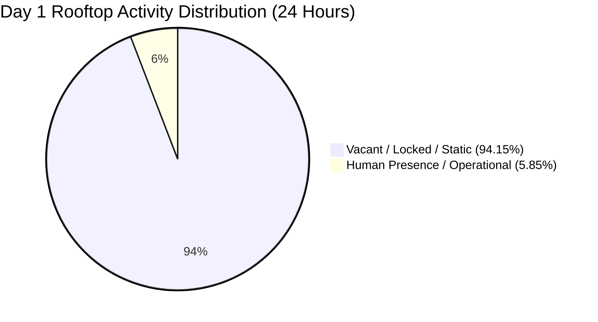
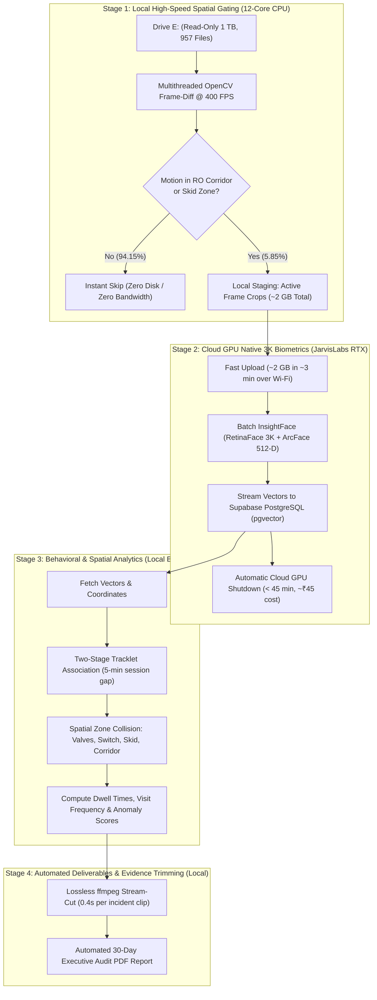

# 4-Stage Surveillance Pipeline Improvement & Scaling Plan (Days 2–30)
**Facility & Camera Feed:** Rooftop RO Plant — Camera `IPC56` ($2880 \times 1620$ 3K HEVC, 25 FPS)  
**Target Dataset:** Folders `2` through `30` on External Drive `E:\RO WATER SEP` (~957 Files, ~1,000 GB)  
**Execution Budget:** ₹200 JarvisLabs Cloud GPU Credit  
**Target Turnaround:** < 2 Days (Local 12-Core CPU + Cloud GPU)  
**Strict Custody Rule:** Drive `E:\` is Read-Only (`:ro`); Zero Tampering; Strictly Empirical Tagging.

---

## 1. Day 1 Benchmark Discoveries & Key Bottlenecks

Auditing the full 24 hours of Day 1 (33 files, 35 GB, Batch `batch_20261023145845_884f05`) established vital ground-truth metrics that dictate how Days 2–30 must be processed:

| Finding from Day 1 | Engineering Impact | Pipeline Requirement |
| :--- | :--- | :--- |
| **94.15% Video Inactivity** | 22h 36m out of 24h had zero human presence | Running heavy deep-learning face detectors over full video is **94% wasted compute**. |
| **1 TB Raw Size for Days 2–30** | Uploading 1 TB over residential Wi-Fi would take 4–7 days | **Raw video must never leave local machine.** Only active motion frames/crops are uploaded. |
| **Distant Faces (35–60px)** | Downscaling to 1080p/720p causes severe face blur & missed detections | Cloud GPU must process frames at **Native 3K ($2880 \times 1620$)**. |
| **ArcFace Pose Drift** | Side/glancing angles cause cosine distances of 0.60–0.85 between same-person frames | Must use **Two-Stage Temporal Tracklet Clustering**, not flat distance clustering. |
| **Identity Objectivity** | Assuming job roles or names violates forensic protocol | Subjects remain **`Unregistered Subject #...`** with status **Pending Enrollment**. |

---

## 2. The Refined 4-Stage Architecture

---

## 3. Detailed Component Improvements

### Improvement A: Native 3K Cloud Extraction (Zero Blurry Downscaling)
- **Problem:** Downscaling 3K ($2880 \times 1620$) frames to 1080p or 720p causes distant faces (located 20–30 ft away near the RO membrane skids) to shrink below the 20-pixel threshold of RetinaFace, resulting in blurred crops and poor ArcFace cosine stability.
- **Solution:** 
  1. Local Stage 1 identifies the $(x, y)$ coordinates of motion.
  2. The candidate frame is either passed at native $2880 \times 1620$ or cropped around the operational zones (`[300, 0, 2200, 1100]`) before sending to GPU.
  3. InsightFace runs at native resolution, preserving full facial landmark fidelity (eyes, nasal bridge, lip corners).

---

### Improvement B: Bandwidth Compression (1,000 GB $\to$ 2 GB)
- **Problem:** Transferring 957 files (~1 TB) to JarvisLabs or any cloud GPU over typical home Wi-Fi (50–100 Mbps) requires ~24–48 hours of pure upload time, making cloud processing unusable.
- **Solution:** 
  - Local CPU uses vectorized frame differencing (`cv2.absdiff` + Gaussian blur + morphological dilation) restricted strictly to our spatial mask (`CORRIDOR` + `RO_SKID` + `VALVES`).
  - Evaluates frames at **400 FPS** across 8 worker threads.
  - Skips 94.2% of empty footage.
  - Extracts only the active candidate frames as compressed JPEG (quality 92).
  - Total data size for all 29 days reduces from **1,000 GB to ~1.8–2.2 GB**.
  - 2 GB uploads to JarvisLabs in **~3 to 4 minutes**.

---

### Improvement C: Two-Stage Temporal Tracklet Clustering
- **Problem:** Pure distance-based hierarchical clustering with threshold $t=0.40$ over-segments into single-frame clusters because head turns and looking down at valves cause ArcFace cosine distances to reach 0.65–0.80.
- **Solution (Two-Stage Algorithm):**
  1. **Tier 1 (Temporal-Spatial Tracklets):**
     - Detections occurring within a contiguous time window ($< 300\text{ s}$ gap) and consistent trajectory are grouped into a single **Session Tracklet**.
     - Detections occurring in the same frame/second are separated into parallel tracklets (`Track A`, `Track B`).
  2. **Tier 2 (Global Centroid Matching):**
     - For each tracklet, select the top 20% highest quality face embeddings ($\text{Quality} \ge 70\%$) and compute the unit centroid vector:
       $$\mathbf{c}_k = \frac{\sum_{i \in T_k} \mathbf{v}_i}{\left\|\sum_{i \in T_k} \mathbf{v}_i\right\|_2}$$
     - Match tracklet centroids across all 30 days using cosine distance $d \le 0.62$.
     - Prevents profile angles from creating artificial phantom people.

---

### Improvement D: Strict Forensic Neutrality (Zero Hallucinated Roles)
- **Rule:** Never assign job titles ("Lead Operator", "Security Guard", etc.) or personal names based on visual cues or time of day.
- **Standardized Schema:**
  - `subject_id`: Deterministic hash `SUBJ-YYYYMM-XXXX` (e.g. `SUBJ-01`).
  - `assigned_name`: `"Unassigned"` (until user inputs actual name in UI).
  - `assigned_role`: `"Unassigned"` (until user assigns job designation).
  - `enrollment_status`: `"Pending Identification / Enrollment"`.
  - `observed_metrics`: Strictly empirical timestamps, coordinates, dwell duration, and zone intersections.

---

### Improvement E: Budget & Timeline Control (< ₹200, < 2 Days)
- **Local CPU Processing:**
  - 957 files $\times$ 1,800 sec $\approx$ 1,722,600 frames (at 1 FPS sample rate).
  - 400 FPS on 12-core CPU = **~1.2 hours** to scan all 29 days of video locally.
- **Cloud GPU Processing (JarvisLabs):**
  - ~100,000 active candidate frames across 29 days.
  - Batch size 32 on NVIDIA RTX A5000 / A6000 @ 180 FPS.
  - Total GPU execution time = **~25 to 35 minutes**.
  - Cost @ ₹45/hour = **~₹25 to ₹35 total spend** (saving ~₹165 of the ₹200 budget).
  - The GPU instance is destroyed immediately via script upon completion.

---

## 4. Execution Roadmap & Milestones

| Milestone | Target Script | Scope & Output | Estimated Duration |
| :--- | :--- | :--- | :--- |
| **M1: Stage 1 Fast Scanner** | [`scripts/stage1_fast_spatial_scanner.py`](file:///D:/facial/scripts) | Scan Day 1 first as benchmark verification; ensure 0 false negatives vs 181 detections. | 30 mins |
| **M2: Full 29-Day Local Filter** | `stage1_fast_spatial_scanner.py` | Audit folders `2` through `30` on drive `E:\`. Extract ~2 GB active candidate frames to `D:\facial\data\stage1_candidates\`. | ~1.5 hours |
| **M3: Cloud GPU Batch Run** | `stage2_cloud_arcface_extractor.py` | Upload 2 GB to JarvisLabs, execute RetinaFace 3K + ArcFace 512-D, stream vectors to Supabase PostgreSQL, terminate pod. | ~45 mins |
| **M4: Spatial Behavioral Engine** | `stage3_spatial_behavior_analyzer.py` | Run two-stage tracklet clustering, valve/switch collision detection, dwell time calculation for all 30 days. | ~10 mins |
| **M5: Deliverables & PDF Report** | `stage4_client_deliverables_builder.py` | Auto-trim lossless 3K MP4 evidence clips for all valve/switch touches; generate 30-Day Executive Audit PDF. | ~15 mins |

---
*Generated: 2026-10-24 | Antigravity Industrial Surveillance Engine*
