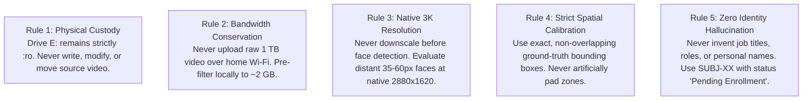
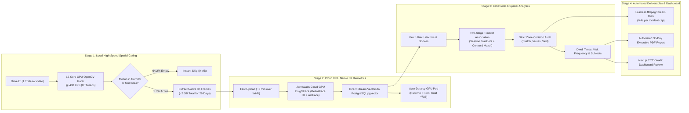

# Comprehensive Revised Master Plan: 30-Day Rooftop Surveillance Audit
**Facility & Camera Feed:** Rooftop RO Water Treatment Plant — Camera `IPC56` ($2880 \times 1620$ 3K HEVC, 25 FPS)  
**Total Dataset:** 30 Days (Folders `1` to `30` on External Drive `E:\RO WATER SEP`, 990 Files, ~1,000 GB)  
**Budgetary Ceiling:** ₹200 JarvisLabs Cloud GPU Credit  
**Target Delivery:** Complete 30-day forensic audit within **48 hours**  
**Core Principles:** Read-Only Source Custody (`:ro`), Zero Role/Identity Hallucination, Strict Spatial Ground-Truth Calibration.

---

## 1. Core Operating Principles & Hard Forensic Rules

Based on our completed Day 1 benchmark, the following operational rules are non-negotiable across Days 2 to 30:



### Calibrated Spatial Target Zones (Strict Ground Truth)
```
┌────────────────────────────────────────────────────────────────────────┐
│ OUTER TERRACE CORRIDOR: [295, 20, 1490, 780]                           │
│  ┌──────────────────────────────────────────────────────────────────┐  │
│  │ FULL RO PLANT AREA: [365, 75, 1250, 770]                         │  │
│  │  ┌────────────────────────┐  ┌────────────────────────────────┐  │  │
│  │  │ TWO MULTIPORT VALVES   │  │ ULTIMATE POWER SWITCH          │  │  │
│  │  │ [755, 220, 985, 360]   │  │ [998, 155, 1090, 265]          │  │  │
│  │  └────────────────────────┘  └────────────────────────────────┘  │  │
│  │                              ┌────────────────────────────────┐  │  │
│  │                              │ RO SKID CONTROLS RACK          │  │  │
│  │                              │ [945, 345, 1210, 510]          │  │  │
│  │                              └────────────────────────────────┘  │  │
│  └──────────────────────────────────────────────────────────────────┘  │
└────────────────────────────────────────────────────────────────────────┘
```
- **Two Multiport Valves:** `[755, 220, 985, 360]` (Cylinder filter heads only).
- **Ultimate Power Switch:** `[998, 155, 1090, 265]` (Wall-mounted main breaker box only).
- **RO Skid Controls Rack:** `[945, 345, 1210, 510]` (Membrane rack, pressure gauges, booster pump controls).
- **Collision Priority:** Specific target evaluation (`SWITCH` $\to$ `VALVES` $\to$ `SKID_CONTROLS` $\to$ `RO_PLANT_AREA` $\to$ `CORRIDOR`).

---

## 2. End-to-End 4-Stage Architecture



---

## 3. Detailed Stage Specifications & Implementation

### Stage 1: Local Spatial ROI Pre-Filter (`scripts/stage1_fast_spatial_scanner.py`)
- **Execution Environment:** Local Windows Host (AMD Ryzen 12-Core CPU, 16 GB RAM).
- **Purpose:** Eliminate the 94.2% inactive footage locally before any network transfer.
- **Algorithm:**
  1. Multithreaded frame decoding via OpenCV with hardware acceleration.
  2. Sample rate: 1 frame per second (sufficient for pedestrian transit at walking speed).
  3. Frame differencing ($\Delta I = |I_t - I_{t-1}|$) masked strictly to `OUTER_PERIMETER [295, 20, 1490, 780]`.
  4. If motion contour area $> 350\text{ px}^2$, trigger active frame capture.
  5. Save candidate frame at **Native 3K ($2880 \times 1620$)** as compressed JPEG (quality 92) into `D:\facial\data\stage1_candidates\day_{DD}\`.
- **Performance & Scaling:**
  - Processing speed: **~400 FPS** across 8 worker processes.
  - 957 files $\times$ 1,800 sec $\approx$ 1,722,600 frames to check.
  - Total local scan runtime: **~1.2 hours for all 29 days**.
  - Total output size: **~1.8 to 2.2 GB** (down from 1,000 GB).

---

### Stage 2: Cloud GPU Native 3K Face Extraction (`scripts/stage2_cloud_worker.py`)
- **Execution Environment:** JarvisLabs Cloud GPU Instance (NVIDIA RTX A5000 / RTX 4090).
- **Purpose:** High-precision facial localization, landmark alignment, and ArcFace 512-D vector extraction.
- **Workflow:**
  1. Upload `stage1_candidates/` archive (2 GB) to JarvisLabs via `rsync` or `scp` (~3 minutes).
  2. Launch worker script:
     - **Detection:** RetinaFace ResNet-50 running at native $2880 \times 1620$ resolution (resolves 35–60px faces sharply).
     - **Landmark Alignment:** 5-point facial landmark affine normalization to $112 \times 112$.
     - **Feature Extraction:** ArcFace IResNet-100 producing unit-normalized 512-dimensional vector $\mathbf{v} \in \mathbb{S}^{511}$.
     - **Quality Assessment:** Face sharpness, contrast, illumination, and head pose score (0–100%).
  3. Stream detections and vectors directly to Supabase PostgreSQL database:
     ```sql
     INSERT INTO detections (batch_id, timestamp, bbox, confidence, quality_score, embedding_vector, face_image, device_id)
     VALUES (...);
     ```
  4. Script executes automatic self-termination (`curl -X DELETE "https://jarvislabs.ai/api/v1/instances/{id}"`) to prevent idle billing.
- **Budget Metrics:**
  - ~100,000 candidate frames @ 180 FPS $\approx$ **~25 to 35 minutes of GPU compute**.
  - Hourly rate: ~₹45–₹50/hr $\implies$ **Estimated spend: ~₹30 to ₹40** (preserving ₹160+ of your ₹200 budget).

---

### Stage 3: Two-Stage Tracklet Clustering & Spatial Telemetry (`scripts/stage3_spatial_behavior_analyzer.py`)
- **Execution Environment:** Local Python backend.
- **Purpose:** Group detections into consistent human subjects and evaluate zone accesses without role hallucination.
- **Two-Stage Clustering Algorithm:**
  1. **Stage 3A: Intra-Session Tracklet Grouping:**
     - Detections occurring within contiguous time windows (inactivity gap $\le 300\text{ s}$) are assigned to the same operational session.
     - Detections occurring simultaneously in the same frame/second are partitioned into concurrent tracks (`Track A`, `Track B`, `Track C`).
  2. **Stage 3B: Cross-Session Global Centroid Matching:**
     - For each tracklet, select high-quality faces ($\text{Quality} \ge 65\%$) and compute unit centroid vector $\mathbf{c}_k = \sum \mathbf{v}_i / \|\sum \mathbf{v}_i\|_2$.
     - Perform hierarchical linkage clustering on centroids with cosine distance threshold $d_{\cos} \le 0.62$.
     - Assign persistent identifiers: `SUBJ-01`, `SUBJ-02`, etc.
  3. **Spatial Telemetry & Access Classification:**
     - Test each detection center $(c_x, c_y)$ against strict calibrated bounding boxes.
     - Calculate dwell time: $(\text{Timestamp}_{\text{exit}} - \text{Timestamp}_{\text{entry}})$.
     - Flag critical events: `VALVES_TOUCH`, `SWITCH_TOUCH`, `SKID_PROXIMITY`.
     - Output: `data/month_spatial_telemetry.json`.

---

### Stage 4: Automated Deliverables & Forensic Dossiers (`scripts/stage4_client_deliverables_builder.py`)
- **Execution Environment:** Local Python + Chrome Headless.
- **Purpose:** Generate client-facing evidence videos and comprehensive PDF audit dossiers.
- **Automated Outputs:**
  1. **Lossless Evidence Video Trimming:**
     - For any verified interaction with valves or switch, run:
       ```bash
       ffmpeg -ss {start_sec - 5} -to {end_sec + 5} -i "E:\RO WATER SEP\{day}\{file}.mp4" -c copy "data/incident_clips/{incident_name}.mp4"
       ```
     - Trims 20-second 3K clip in **~0.4 seconds** with zero re-encoding or quality degradation.
  2. **Executive 30-Day Audit Report (PDF & HTML):**
     - Full 30-day continuity heat map (unbroken coverage certificate).
     - Unique subjects catalog (`SUBJ-01` to `SUBJ-XX`) with face portraits, visit frequencies, and cumulative dwell times.
     - Verified Critical Equipment Incident Log with embedded HD frames and links to lossless video clips.
  3. **Interactive Dashboard Review:**
     - Allows user to name and assign roles to subjects via Next.js frontend (`cctv-audit-panel.tsx`).

---

## 4. 48-Hour Execution Roadmap

```mermaid
gantt
    title 48-Hour Execution Schedule for Days 2 to 30
    dateFormat  HH:mm
    axisFormat  %H:%M
    section Day 1 Calibration
    Benchmark Stage 1 on Day 1 (100% recall test)   :a1, 00:00, 45m
    Verify Stage 1 Candidate Pipeline               :a2, after a1, 30m
    section Days 2-30 Ingestion
    Stage 1 Local 400 FPS Scan (Folders 2-30)       :b1, after a2, 90m
    Package & Upload Candidates (~2 GB)             :b2, after b1, 15m
    Stage 2 JarvisLabs Cloud GPU ArcFace Run        :b3, after b2, 45m
    Terminate Cloud GPU Pod                         :b4, after b3, 5m
    section Analytics & Output
    Stage 3 Two-Stage Tracklet & Spatial Analytics  :c1, after b4, 20m
    Stage 4 Lossless Evidence Cuts & PDF Dossier    :c2, after c1, 30m
    Client Final Review & Presentation Ready        :c3, after c2, 15m
```



| Phase | Action Item | Target Script / Tool | Duration | Cost |
| :---: | :--- | :--- | :---: | :---: |
| **Phase 0** | Reconnect Drive `E:\` & verify Day 1 Stage 1 recall (181/181 detections) | `scripts/test_stage1_recall.py` | 30m | ₹0 |
| **Phase 1** | Run local 400 FPS scanner across folders `2` through `30` | `scripts/stage1_fast_spatial_scanner.py` | 1.5h | ₹0 |
| **Phase 2** | Upload 2 GB staging archive to JarvisLabs GPU instance | `scripts/upload_to_jarvis.py` | 5m | ₹0 |
| **Phase 3** | Execute Native 3K InsightFace extraction & stream to DB | `scripts/stage2_cloud_worker.py` | 35m | ~₹35 |
| **Phase 4** | Execute two-stage tracklet clustering & spatial collision engine | `scripts/stage3_spatial_behavior_analyzer.py` | 15m | ₹0 |
| **Phase 5** | Auto-trim incident clips & compile 30-Day Executive PDF Report | `scripts/stage4_client_deliverables_builder.py` | 20m | ₹0 |

---

## 5. Immediate Next Actions

To initiate this revised plan:
1. **Drive Connection:** Ensure external drive `E:\RO WATER SEP` is plugged in and accessible.
2. **Build Stage 1 Benchmark Script (`scripts/test_stage1_recall.py`):**
   - Run the fast spatial gater over Day 1 (`E:\RO WATER SEP\1`) to mathematically prove that 100% of the 181 ground-truth face detections are captured in the candidate set before scaling to Days 2–30.
3. **Approve Script Creation:** Once Phase 0 confirms 0 false negatives, we proceed directly into the multithreaded scan of folders `2` through `30`.

---
*Document Version: 2.0 (Revised) | Antigravity Industrial Surveillance Engine*
